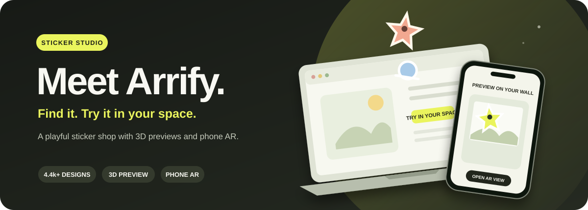

# Arrify

<div align="center">
  
  <br />
  <a href="https://stickitup-ar-demo.vercel.app"></a>
  <a href="https://www.stickitup.xyz/"></a>
  <br /><br />
  
  
  
</div>

<p align="center"><strong>Discover a sticker. See it in 3D. Try it in your space.</strong></p>

Arrify is an independently built, AI-assisted sticker storefront and augmented reality (AR) demo. It brings together a captured STICK IT UP catalog, product browsing, a persistent demo cart, 3D previews, native phone AR handoff, a sticker layout studio, and a poster studio.

<p align="center"><a href="#what-you-can-do">Explore features</a> · <a href="#run-locally">Run locally</a> · <a href="#technology-stack">Tech stack</a> · <a href="#future-scope">Roadmap</a> · <a href="#ai-tools-and-review-agents">AI usage</a></p>

**Live demo:** [stickitup-ar-demo.vercel.app](https://stickitup-ar-demo.vercel.app) · **Original store:** [stickitup.xyz](https://www.stickitup.xyz/)

This repository is a review/demo application, not the store's production commerce backend. The live demo uses captured product data; demo checkout does not take payment or create a real order.

## What you can do

- Browse a captured catalog of **4,475 stickers and apparel products**, **5,191 variants**, **157 collections**, and **26,865 image records**. The snapshot includes sold-out products and preserves their recorded availability.
- Search, filter, sort, paginate, compare product options, and view product details using locally served catalog pages.
- Build a cart with server-quoted captured prices and browser persistence. Use the demo checkout to exercise form validation and a clearly labeled sample discount.
- Preview supported stickers in interactive 3D, prepare native AR assets, and open a phone handoff using a QR code.
- Arrange multiple cart stickers together, edit their position/size/rotation, and prepare a combined scene for a phone.
- Explore a captured Posterized catalog, preview poster product photos on a wall, and arrange a multi-photo wall layout.
- Browse the captured storefront content, including the quiz, sticker discovery, editorial pages, FAQs, and policy pages.

## How the project works

```text
Captured public catalog and page content
                │
                ├── data/ and reference/ ──> Node page renderer ──> browser storefront
                │                                  │
                │                                  └── /api ──> cart quotes, AR prep and handoff
                │                                                    │
                └── prepared sticker assets ──> Cloudflare R2 <─────┘
                                                     │
                                      GLB / USDZ / QR phone handoff
```

The application reuses one Node request handler locally and in the Vercel function. The server renders public product and collection pages from the saved catalog. Browser JavaScript handles interactions, while the server validates variants and quantities and calculates cart quotes from captured prices. Prebuilt AR catalog files are served from Cloudflare R2; temporary edited scenes and phone handoff data use the configured server-side R2 storage path. Local development can use the available fallback storage when R2 settings are absent.

The catalog snapshot is dated **19 October 2026**. Product prices and availability can change on the real store. Product images mostly load from the original Shopify image CDN, so those images need internet access. The repository is not a live Shopify Storefront API integration.

## Technology stack

| Area | Technology |
| --- | --- |
| Runtime and server | Node.js 22+, native ES modules, Node HTTP request handler |
| UI | Server-rendered HTML, browser JavaScript modules, CSS; no React/Vue application framework |
| Catalog capture and HTML handling | Cheerio, local JSON snapshots, HTML sanitization and rewriting |
| Image and AR preparation | Sharp, generated PNG textures, GLB models, USDZ models and QR codes |
| 3D and browser AR | Google `<model-viewer>` 4.4.0 (vendored, with provenance recorded), GLB/glTF |
| Native phone handoff | Apple Quick Look USDZ links, Android Scene Viewer intents, QR scene links |
| Storage | Cloudflare R2 through the AWS S3 client; Vercel Blob and local fallback paths remain in the code |
| Hosting | Vercel Node function and static assets; local Node server for development |
| Quality checks | Node's built-in test runner, browser checks documented in `docs/`, GitHub Actions |

Notable direct dependencies are `@aws-sdk/client-s3`, `@vercel/blob`, `cheerio`, `fflate`, `qrcode`, and `sharp`. There is no frontend bundler or transpilation step in the current app.

## Run locally

Requires Node.js 22 or newer.

```sh
npm ci
npm run dev
```

Open the localhost address printed by the server (port 3000 by default). To choose another port in PowerShell:

```powershell
$env:PORT = '3001'
node server.mjs
```

R2 is optional for basic local development. For durable prepared assets and temporary AR handoffs, configure `R2_ENDPOINT`, `R2_ACCESS_KEY_ID`, `R2_SECRET_ACCESS_KEY`, and optionally `R2_BUCKET` as server-side environment variables. The asset base URL is configured separately with `AR_ASSET_BASE_URL`. Never put these credentials in browser code or commit them. See [Cloudflare R2 setup](docs/cloudflare-r2-setup.md). The R2 development URL is rate limited; the project notes recommend a custom asset domain for public production traffic. No hard billing cap is configured.

## Useful commands

| Command | Purpose |
| --- | --- |
| `npm run dev` | Start the local storefront and API |
| `npm test` | Run all Node tests |
| `npm run build` | Run the build checks and create the portable `dist/` app |
| `npm run sync` | Refresh the captured sticker catalog |
| `npm run sync:posters` | Resume the public poster catalog capture |
| `npm run audit:posters` | Audit poster images and generate browse thumbnails |
| `npm run build:poster-ar` | Generate poster preview GLBs and normalized textures |

Catalog sync commands update the local source snapshot. Review the resulting data before publishing; source prices and availability become stale over time. For a production-shaped local install, build first, then run `npm ci --omit=dev` and `npm start` from `dist/`.

## Repository map

| Path | Responsibility |
| --- | --- |
| `server.mjs`, `api/index.mjs` | Shared local and Vercel HTTP entry points |
| `lib/` | Rendering, catalog logic, HTML processing, AR models, storage and handoff |
| `public/` | Browser interactions, styles, assets, studios and vendored model viewer |
| `data/` | Captured product, collection, poster and AR catalog data plus provenance |
| `reference/` | Retained source pages, route map and analysis records |
| `scripts/` | Capture/sync, asset preparation, auditing, packaging and build tools |
| `tests/` | Node test suite |
| `docs/` | Product direction, design, research, release notes and verification evidence |
| `.github/workflows/ci.yml` | Install, test, build and upload the portable app artifact on push and pull request |

## Current status and project boundaries

The latest project readiness record, dated **25 October 2026**, documents a deployed Vercel demo, a verified 12,435-object AR catalog on R2, public asset and CORS checks, model/scene/QR handoff checks, and browser verification of the sticker and cart studios. The latest AR controls release records **53 passing tests** and a complete portable build at that point. These are recorded results from the cited release work, not a fresh run made while editing this README.

The demo is useful for reviewing shopping and placement workflows, but it is not yet production commerce or a guarantee of precise physical placement:

- Prices, stock, and product details are from a dated capture.
- Checkout, accounts, fulfillment, discount rules, newsletter signups, reviews and support submissions are demo/local behavior or need owner-authorized service integrations.
- Generated AR artwork is a preview derived from product photography, not approved print artwork. Some source images include shadows, promotional elements or scenes.
- AR sizing is an estimate unless verified per-product dimensions are supplied. Browser preview and desktop QR checks do not prove physical tracking.
- Physical iPhone and Android placement, especially upright walls and laptop lids, still needs current-device validation.
- Temporary scene API links expire after 30 minutes, but stored scene objects still need retention cleanup.
- The shared public R2 bucket is for public sticker assets and scene previews only; it is not suitable for private media.
- The project is marked `noindex`; it is not intended to replace or index the original store.

See [MVP readiness](docs/mvp-readiness-2026-10-25.md), [AR controls release](docs/ar-controls-release-2026-10-25.md), [verification notes](docs/verification.md), and [poster studio verification](docs/poster-studio-verification.md) for the dated evidence and its limits.

## How we build and review

Work follows an evidence-first loop:

1. Capture or inspect the public source and keep the snapshot provenance in the repository.
2. Make a focused change while preserving the existing catalog, cart, and route contracts.
3. Add regression coverage for behavior that can be checked locally.
4. Run the Node test suite and portable build; inspect relevant flows in a browser.
5. For deployed changes, verify the public HTTPS routes and assets separately from local results.
6. Record evidence and open gaps in the relevant release or verification document.

GitHub Actions runs `npm ci`, `npm test`, and `npm run build` for pushes and pull requests, then uploads `dist/` as an artifact. This workflow verifies and packages the app; it does not itself deploy to Vercel.

### AI tools and review agents

This repository has been developed with AI-assisted coding, investigation and review. The release notes identify the following tools and review roles:

- **Codex** — the named coding assistant in the project’s event log. The current local README and repository work were also prepared with Codex.
- **REA (Reverse Engineer Anything)** — static inspection of retained storefront theme JavaScript and evidence handling; static inspection was explicitly treated as partial and not proof of runtime behavior.
- **AR engineering review agent** — reviewed model generation, native handoff and AR implementation.
- **Artwork review agent** — reviewed representative cleaned artwork and documented where automated cleanup is unreliable.
- **Cart UX review agent** — reviewed cart and multi-sticker arrangement behavior.
- **Independent software review agent(s)** — reviewed storage and concurrency changes; the 25 October readiness note records a race found and fixed.
- **Agent Reach research tooling** — used for public-source research; its recorded access limitations are described in `docs/ar-expert-review.md`.

The [AI usage log](https://github.com/krthik20050/arrify/blob/main/AI_USAGE.md) is the place to record hackathon work. At the time of this README update, its participant task row is still a TODO; it records Codex preparing the project documentation template. The source release notes separately identify three specialist review agents (AR engineering, artwork, and cart UX) and an independent software review, but omit their model names and identities. Those documented roles are credited above; the repository does not contain enough evidence to name every historical agent or model. Agent review is software-agent output, not external human certification.

## Future scope

Priorities below are derived from the open boundaries in the current project notes. They are direction, not completed features.

### P0 — validate the core phone experience

- Run a repeatable acceptance pass on current iPhone Safari and ARCore Android devices: product launch, scale gestures, surface changes, orientation, texture alignment, QR handoff, and multi-sticker cart layout.
- Record device, OS/browser, lighting and surface conditions; keep native device results separate from desktop/browser preview evidence.
- Confirm a custom R2 asset domain and production CORS behavior before relying on the rate-limited development domain for broader traffic.

### P1 — improve asset quality and storage operations

- Obtain owner-approved transparent print artwork, die-cut masks and measured dimensions by SKU; keep automated image cleanup as a labeled preview fallback.
- Add retention cleanup for expired temporary GLB/USDZ/scene/QR objects and document storage monitoring and recovery.
- Replace estimated AR dimensions with verified product dimensions when the source data is available.
- Review accessibility with screen readers and measure the README's stated performance budgets on representative mobile connections.

### P2 — connect real commerce services

- Integrate owner-approved product/stock updates, customer authentication, checkout/payment, order management, fulfillment, discounts, reviews, newsletter and support services.
- Define privacy, retention, consent and operational ownership before collecting customer or camera-related data. The current studio does not upload camera frames.
- Explore guided surface recognition and more capable in-AR multi-sticker editing only after device tests establish the value and platform limits.

## Key documentation

- [Product direction](PRODUCT.md) and [design system](DESIGN.md)
- [MVP readiness and deployed evidence](docs/mvp-readiness-2026-10-25.md)
- [Verification record](docs/verification.md)
- [AR prototype and known platform limits](docs/ar-prototype.md)
- [AR placement and hosting](docs/ar-placement-and-hosting.md)
- [Cloudflare R2 setup and operations](docs/cloudflare-r2-setup.md)
- [AR artwork audit](docs/ar-artwork-audit.md)
- [Cart arrangement flow](docs/cart-arrangement-flow.md)
- [Sticker studio](docs/sticker-studio.md)
- [Poster studio plan and verification](docs/poster-studio-plan.md), [poster studio verification](docs/poster-studio-verification.md)

## Acknowledgements and source use

The product catalog, names, descriptions, prices, brand identity and source photographs belong to their respective rights holders. This project uses captured public pages and catalog data for a review/demo recreation, preserves source attribution in its data and docs, and links shoppers back to the original store for poster purchases. Confirm permission and asset rights before redistributing captures or using this repository as a commercial storefront.

